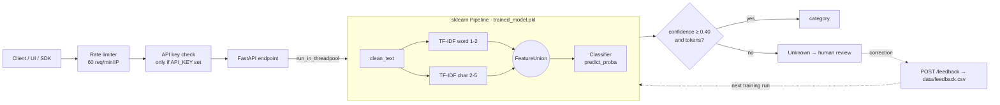

<div align="center">
  
  <h1>NextBill Invoice Expense Classifier</h1>
  <p><b>FastAPI + scikit-learn service that turns raw invoice text into an expense category.</b></p>
  <p>
    
    
    
    
    
  </p>
  <p><a href="docs/handover.html"><b>📘 Styled handover guide (open in browser)</b></a></p>
</div>

```json
POST /predict   {"text": "Blue Dart courier charges for warehouse delivery"}
→ 200           {"category": "Logistics", "confidence": 0.93, "alternatives": [...], ...}
```

---

## Contents
1. [Problem & approach](#1-problem--approach)
2. [Quick start](#2-quick-start)
3. [Architecture](#3-architecture)
4. [Project layout](#4-project-layout)
5. [ML pipeline](#5-ml-pipeline)
6. [API reference](#6-api-reference)
7. [Evaluation](#7-evaluation)
8. [Operations: feedback loop, config, Docker](#8-operations)
9. [Testing & CI](#9-testing--ci)
10. [Known limits & next steps](#10-known-limits--next-steps)

---

## 1. Problem & approach

| | |
|---|---|
| **Input** | Free-text invoice line, e.g. `"AWS monthly cloud hosting bill"` |
| **Output** | One of `Logistics`, `Office Supplies`, `Cloud/Software`, `Utilities`, `Travel`, `Inventory` — or `Unknown` when the model is not confident |
| **Model** | 100% learned: TF-IDF (word + character n-grams) → best of 3 linear classifiers picked by cross-validation. **No keyword rules.** |
| **Why this model** | Invoice lines are short, vocabulary-heavy and brand-heavy (Blue Dart, BESCOM, Zoho). Linear models on sparse n-grams are the industry baseline here: ~1 ms inference, ~1 MB artifact, explainable, retrain in seconds. A transformer adds ~400 MB and GPU cost for little gain on 6 classes. |

---

## 2. Quick start

```bash
pip install -r requirements.txt
python -m data.generate_data        # 1) synthetic training data -> data/training_data.csv
python -m training.train_model      # 2) train + evaluate -> training/trained_model.pkl, metrics.json
uvicorn app.main:app --reload       # 3) serve on http://localhost:8000
```

| URL | What |
|---|---|
| `http://localhost:8000/` | Sandbox UI (type an invoice, see category, confidence, tokens, top-3) |
| `http://localhost:8000/docs` | Swagger / OpenAPI |

`make setup && make run` does the same. Docker: `docker compose up --build`.

---

## 3. Architecture



**Key decisions**

| Decision | Reason |
|---|---|
| Preprocessing lives *inside* the sklearn Pipeline | Training and serving use the exact same code path → no train/serve skew. |
| Inference in `run_in_threadpool` | sklearn is CPU-bound; keeps the async event loop free. |
| Batch = one `predict_proba` call | Vectorized; far cheaper than N single calls. |
| `Unknown` below 0.40 | In finance, a wrong auto-booking costs more than a manual review. |
| No NLTK | Regex + sklearn stopwords; char n-grams cover plurals/typos. No runtime downloads, smaller image. |

---

## 4. Project layout

```text
app/
  main.py            FastAPI app: endpoints, auth, rate limit, metrics, feedback
  classifier.py      Loads pipeline, predict_many() -> category/confidence/top-3
  models.py          Pydantic request/response schemas (input validation)
  config.py          All settings (env-overridable via .env)
  index.html         Sandbox UI
preprocessing/
  text_processor.py  clean_text(): lowercase, alpha tokens, stopwords
training/
  train_model.py     Dedupe → CV model selection → held-out eval → save
  trained_model.pkl  Artifact (generated)
  metrics.json       Evaluation (generated, served by /metrics)
data/
  generate_data.py   Synthetic data generator
  training_data.csv  Sample training data
  eval_realistic.csv 36 hand-written invoices, never used for training
  feedback.csv       Human corrections (created at runtime)
sdk/client.py        Zero-dependency Python client
tests/               50 pytest tests (API, classifier, preprocessing, SDK, realistic eval)
```

---

## 5. ML pipeline

`python -m training.train_model` runs:

1. **Load** `training_data.csv` + `feedback.csv` (if present); drop rows with unknown labels.
2. **Deduplicate** (case-insensitive). The generator produces ~30% duplicates; without this they leak across the split and inflate scores.
3. **Stratified 80/20 split** (`random_state=42`).
4. **Model selection** — 5-fold stratified CV, macro-F1, on the 80%:

   | Candidate | Features | Classifier |
   |---|---|---|
   | `logreg` | word(1-2) + char_wb(2-5) TF-IDF, sublinear tf | LogisticRegression, `C=10`, balanced |
   | `linear_svc_calibrated` | same | LinearSVC + `CalibratedClassifierCV` (real probabilities) |
   | `complement_nb` | same | ComplementNB, `alpha=0.3` |

5. **Held-out report** — classification report + confusion matrix on the 20%.
6. **Realistic eval** on `eval_realistic.csv`.
7. **Final fit** of the winner on all unique data → `trained_model.pkl`; numbers → `metrics.json`.

---

## 6. API reference

Auth is **off by default** (matches the assignment). Set `API_KEY=...` to require header `x-api-key` on predict/metrics/feedback (missing/wrong → `401`).

| Method | Path | Body | Returns |
|---|---|---|---|
| `POST` | `/predict` | `{"text": str}` (3–5000 chars) | `category, confidence, alternatives[3], processed_tokens, processing_time_ms` |
| `POST` | `/predict/batch` | `{"texts": [str]}` (1–100) | `predictions[], total_processing_time_ms` |
| `POST` | `/feedback` | `{"original_text", "predicted_category", "actual_category"}` | `{"status": "stored", "feedback_rows": n}` |
| `GET` | `/metrics` | – | live counters + `model_evaluation` from metrics.json |
| `GET` | `/health` | – | `status, model_loaded, model_version, categories` |
| `GET` | `/categories` | – | supported categories |

```bash
curl -X POST localhost:8000/predict -H "Content-Type: application/json" \
     -d '{"text": "AWS monthly cloud hosting bill"}'
```

```python
from sdk.client import NextBillClassifierClient

c = NextBillClassifierClient("http://localhost:8000")
c.classify("Uber rides to airport")  # -> {"category": "Travel", ...}
```

Errors are always `{"success": false, "error": {"code": int, "message": str}}`; internals are never leaked.

---

## 7. Evaluation

| Set | Rows | Score |
|---|---|---|
| Synthetic CV (all 3 models) | 864 | macro-F1 1.00 |
| Synthetic held-out | 216 | accuracy 1.00 |
| **Hand-written realistic** | 36 | **accuracy 94.4%** |

> The synthetic data is template-based, so 1.00 only proves the pipeline works. **Trust the realistic number.** Current misses: `"Jio postpaid mobile bill"` → Inventory, `"Ball pens notebooks envelopes"` → Unknown. `tests/test_realistic_eval.py` fails the build if realistic accuracy drops below 75%.

---

## 8. Operations

**Feedback loop** — UI/clients send corrections to `POST /feedback` → appended to `data/feedback.csv` → re-run `python -m training.train_model` (they are merged in automatically). Schedule that as a cron/CI job in production.

**Config** (`app/config.py`, overridable by env / `.env`):

| Var | Default | Meaning |
|---|---|---|
| `API_KEY` | empty | Empty = open API. Required when `ENVIRONMENT=production` (startup fails otherwise). |
| `CONFIDENCE_THRESHOLD` | `0.40` | Below → `Unknown` |
| `MODEL_PATH` | `training/trained_model.pkl` | Model artifact |
| `ALLOWED_ORIGINS` | localhost | CORS |

**Docker** — the image installs deps, generates data and trains at build time, then serves with uvicorn on `:8000` with a `/health` healthcheck.

---

## 9. Testing & CI

```bash
pytest -q            # 50 tests
ruff check . && ruff format --check .
```

`.github/workflows/ci.yml`: install → generate data → train → lint → format check → tests.

---

## 10. Known limits & next steps

| Limit | Upgrade path |
|---|---|
| Training data is synthetic | Replace with labelled real invoices; keep `eval_realistic.csv` as a frozen benchmark and grow it. |
| Feedback CSV + in-process lock | Move to a DB table when running multiple workers. |
| In-memory rate limiter | Redis / gateway rate limiting for multi-instance deploys. |
| Retraining is manual | Nightly job: train → compare `realistic_accuracy` with current → promote only if better. |
| English only | Add Hindi/Hinglish samples; char n-grams already handle transliteration reasonably. |
